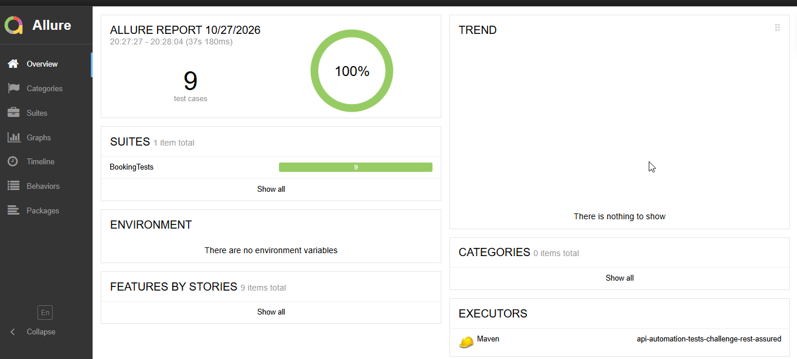

# Desafio de Automação de Testes de API com Rest Assured

## Objetivo

Automatizar testes da API pública [Restful-Booker](https://restful-booker.herokuapp.com) usando Java, Rest Assured e JUnit 5, cobrindo o CRUD de reservas (GET, POST, PUT e DELETE) e cenários negativos, com relatórios do Allure e execução automática no GitHub Actions.

## Créditos

Este projeto é um fork do desafio da [DIO](https://www.dio.me), proposto pela expert **Carolina Louzada**. O repositório original é o `api-automation-tests-challenge-rest-assured`, da própria DIO.

## Tecnologias

- Java 8+ (executado com Java 21 localmente e Java 17 no CI)
- Maven
- Rest Assured 4.5.1 (com json-schema-validator)
- JUnit 5.9.0
- JavaFaker 1.0.2
- Allure 2.19.0 (allure-junit5, allure-rest-assured e AspectJ 1.9.9.1)
- GitHub Actions

## Como rodar

Execute os testes:

```bash
mvn clean test
```

Gere e abra o relatório do Allure no navegador:

```bash
mvn allure:serve
```

## Testes cobertos (9)

**GET**
- Listar reservas retorna 200 e ao menos uma reserva
- Filtrar por `firstname` encontra a reserva recém-criada
- Buscar reserva por id devolve os dados criados
- Buscar id inexistente retorna 404

**POST**
- Criar reserva com dados válidos retorna 200, schema correto e resposta rápida

**PUT**
- Atualizar reserva com autenticação retorna 200 e dados novos
- Atualizar reserva sem autenticação retorna 403

**DELETE**
- Deletar reserva com autenticação retorna 201 e a reserva some
- Deletar reserva sem autenticação retorna 403

## Relatório de testes (Allure)

O relatório gerado pelo Allure mostra os 9 testes passando.



## Melhorias em relação ao original

- **Testes independentes:** cada teste cria os próprios dados, sem depender de reservas pré-existentes ou da ordem de execução.
- **CRUD completo:** além de GET e POST, foram adicionados PUT e DELETE.
- **Cenários negativos:** 404 para reserva inexistente e 403 para PUT e DELETE sem autenticação.
- **Filtro corrigido:** o parâmetro de busca agora é `firstname` (minúsculo), como na documentação da API.
- **Asserção melhor:** a checagem de `results` foi trocada por `bookingid` com `hasItem`, que confirma que a reserva criada aparece na listagem.
- **Autenticação preemptive** nas chamadas PUT e DELETE, porque a API responde 403 (e não 401) quando falta autenticação, então o modo padrão nunca enviaria as credenciais.
- **Schema de Response com preço inteiro:** `totalprice` é `integer` no schema de resposta, e os testes geram preços inteiros.
- **Pipeline no GitHub Actions:** os testes rodam a cada push na `main` e em pull requests, e os resultados do Allure são publicados como artefato.
